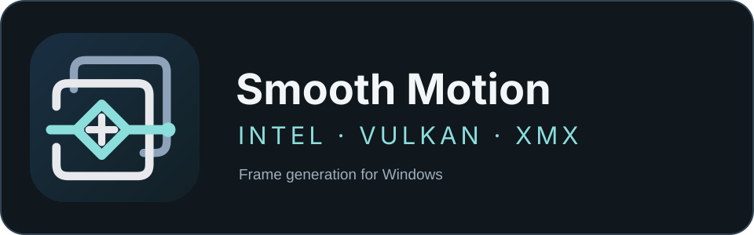

<a href="README.md">English</a> · <strong>简体中文</strong>

Windows 桌面帧生成 · 为 Intel XMX 优化 · 推荐 Arc B390

# Smooth Motion Intel

**[下载 Windows x86_64 便携版](https://github.com/jhckevin/smooth-motion-intel/releases/tag/v0.1.0-preview.3)** · [快速开始](START-HERE.md)

**Full 完整包**提供已编译客户端、原生引擎、**匹配的已转换 Smooth Motion 模型资产**、诊断工具及文档；无需自行编译、提取 DLL 或手动导入模型。首次正常启动需阅读并确认 [模型使用前声明](MODEL-NOTICE.md)。

模型包包括权重与预计算参数、导出计算图、Intel Vulkan/XMX SPIR-V，以及合成启动验证数据。它不是 NVIDIA 原装 DLL。维护者免费提供；第三方模型权利不随项目原创代码的 Apache-2.0 许可转移，免责声明和非盈利发布不构成厂商授权。

面向 Intel GPU 的非官方 Smooth Motion 移植与 Windows 客户端。通过 Vulkan 执行自定义推理，使用 Windows Graphics Capture / DXGI 捕获和 D3D/DXGI 展示。它不使用 XeSS SDK 加载 NVIDIA 模型，也不是 NVIDIA、Intel 或 Lossless Scaling 的官方产品。

**源码仓库公开客户端、运行时和诊断实现；Full Release 另附与引擎匹配的转换模型包。模型资产不适用项目原创代码的 Apache-2.0 许可，相关权利仍属第三方，见模型使用前声明。**

## 作者的项目介绍与体验

以下按作者要求保留原文。画质和游戏体验属于作者在个人设备上的主观观察，不是独立画质评测、所有场景的无损保证或其他显卡的兼容性承诺。

> 作为nvidia smooth motion的Intel优化版本，在B390核显上进行了优化，对其他Intel显卡测试未知，但是毫无疑问有XMX核心的XESS 3核心上肯定效果会较好，在地平线6等游戏上进行了测试两倍插帧，问题不大，画质相对于英伟达版本几乎无损，和LSFG 3.1对比，效果类似。相对于XESS MFG更加泛用，也可以对视频插帧（建议先开全屏），但是性能消耗和效果肯定还是不如能拿到引擎矢量单元的XESS-MFG，适合给视频，不支持xess的老游戏，minecraft等使用。本身其实是专门为panther lake移植的，针对B390核显进行了适配（我的测试版本号是：32.0.101.8274），但是理论上其实针对其他Intel显卡，也可以运行？（我没试过），模型使用vulkcan进行推理
>
> 如果有有价值的问题，可以提出，说不定我会改进。可以选择导出诊断包，我来研究研究适配问题。

技术口径补充：

- **XMX 是硬件矩阵单元；XeSS 3 是软件技术/SDK，不存在“XeSS 3 核心”。** 当前项目运行自定义 Vulkan 模型，不能凭支持 XeSS 或存在 XMX 就保证能运行当前着色器。
- “Vulkcan”指 **Vulkan**。不同 Intel 架构与驱动的扩展、矩阵形状、数据类型、子组以及跨接口互操作支持需要逐项满足。
- 文中的驱动 **32.0.101.8274** 是作者提供的测试版本说明；诊断包记录的当次驱动身份才用于具体故障对齐，不强制此版本，也不自动更换驱动。
- “几乎无损”“与 LSFG 3.1 类似”是作者体验。运动、遮挡、细线、HUD、重复递归插帧与持续低功耗条件仍可能出现差异；仓库没有提供足以证明统一质量分数或普遍优于原版的评测。
- 引擎集成式帧生成可获得运动矢量等信息；本项目的桌面捕获路径通常拿不到这些信息。与 XeSS MFG 的成本/画质对比需在同一设备与场景实测。

## 支持范围

| 设备 | 状态 |
|---|---|
| Intel Arc B390 / Panther Lake | 推荐；已有开发和《地平线 6》2×插帧测试经验 |
| Intel Arc B580 / B570 等独显 | 不按型号封锁；按能力检查。没有这些实机，未验证可用性、性能或画质 |
| 其他 Intel XMX GPU | 满足运行时及当前模型着色器要求时可尝试；未验证 |
| AMD / NVIDIA / 没有相关矩阵能力的设备 | 不是当前优化和验证目标，不承诺支持 |

R995 移除了 B390 设备 ID 和固定队列族的专属门槛。运行时选择具备所需能力的 Intel adapter，D3D 和 Vulkan 必须对应同一 LUID；实际需求和拒绝原因会进入日志。不能通过忽略不支持的功能来冒充兼容。

当前模型包还可能需要 **scalar FP8 转换相关扩展**，即使主要矩阵计算是 FP16。它不等于 FP8 矩阵推理。扩展缺失时需要兼容着色器实现；仅把设备名称改成 B580 不会解决这个问题。见 [硬件兼容说明](docs/COMPATIBILITY.zh-CN.md)。

## 快速开始

1. Windows 10/11 x64，使用已安装且提供所需 Vulkan 能力的 Intel 显卡驱动。本程序不安装驱动或修改系统配置。
2. 下载 Release 的便携客户端，或按 [构建说明](docs/BUILD.zh-CN.md) 编译公开源码。
3. **Full 完整包已附带 model/ 目录**，请保持目录完整。阅读 MODEL-NOTICE.md，并在首次启动确认。仅源码/开发安装才需要额外导入与引擎匹配的已转换模型包；导入器不能自动提取或转换 NVIDIA 原装 DLL。见 [模型资产说明](docs/MODEL-ASSETS.zh-CN.md)。
4. 打开游戏，推荐窗口或无边框模式。启动 SmoothMotion.exe，选择捕获窗口，使用 **2×**、WGC 和跟随游戏叠层开始。
5. 默认快捷键 **Ctrl+Alt+S** 开始/停止，**Ctrl+Alt+Esc** 紧急停止。切换到其他应用、最小化或退出目标游戏时会暂停/停止相应捕获工作。
6. 出现持续花屏、设备丢失或系统响应变差时停止本程序并保留日志，不要关闭系统保护或反复强制测试。

**视频**：可选择播放器窗口，建议先让播放器全屏；DRM/受保护视频、最小化窗口以及部分播放/合成路径可能无法捕获。本项目不是离线视频转码器。

## 客户端功能

- 2×帧生成；4×/8×为递归生成的实验模式，会增加真实推理次数、功耗和累积误差。
- WGC 窗口捕获，以及受前台/显示器条件限制的 DXGI Desktop Duplication 实验路径。
- 游戏窗口叠层、无边框全屏预览、1080p/等处理尺寸/小窗口预览。
- 捕获尺寸、处理尺寸和显示尺寸独立标注。处理可保持原生，也可主动选择按比例的 1080p/1440p 上限。
- 输入透传、游戏配置、快捷键、托盘及持续运行选项；独立预览不提供完整的跨位置绝对鼠标映射。
- 监测原生/生成/展示帧、节奏和延迟；封装功耗与 GPU 驱动功耗域分别标注，传感器无法确认时显示不可用。
- 默认启用可关联的本地诊断，安全停止后可导出诊断 ZIP。

详细设置、已知限制与操作方式见 [使用手册](docs/USER-GUIDE.zh-CN.md)；本次验证范围见 [R996 打包验证](docs/VALIDATION-R996.md) · [此前 R995 验证](docs/VALIDATION-R995.md)。

## 分辨率、延迟与性能

“原生处理”不主动缩小外层输入/输出，不保证模型内部每层都使用全分辨率；当前模型内部包含固定 768×432 多尺度网格。更大输入仍会增加捕获、全分辨率 warp、纹理与合成成本。

提交成功不代表实际显示。30→60 / 60→120 应以有效内容、实际展示节奏、基础帧、延迟和功耗共同判断。这里没有承诺在所有设备或 20 W/PL1 条件下达到稳定倍帧，也没有把 3 W / 6 W 目标写成已达成指标。选择更长时间线缓冲可能减少迟到，但会增加操作延迟。

客户端可持续运行，尚不能把“没有固定测试超时”等同于已完成所有设备的 2–4 小时稳定性验收。

## 问题反馈与诊断

有可复现、有价值的问题欢迎 [提交 Issue](https://github.com/jhckevin/smooth-motion-intel/issues)。请说明游戏/播放器、复现操作、大致时间、设备与驱动、捕获/处理/输出尺寸以及功耗/限帧条件。

安全停止后，进入 **设置 → 本地数据 → 导出诊断包**。记录包括错误原码、关键调用边界、会话/帧/任务/资源关联、设备能力与文件哈希。没有管理员权限要求，不自动上传，不默认保存画面或键鼠输入。请检查包内是否有不希望公开的游戏标题/路径；Issue 页面是公开的。

[诊断手册](docs/DIAGNOSTICS.zh-CN.md) · [字段格式](docs/DIAGNOSTIC994-SCHEMA.md) · [反馈模板](.github/ISSUE_TEMPLATE/bug_report.yml)

日志能缩小排查范围，但不能保证直接解释闭源驱动内核、硬件或突然掉电的根因。环覆盖、缺记录和未验证情况必须写进分析，不能把最后一个调用直接当成根因。维护者不承诺响应时间或一定修复。

## 开源协议与免责声明

项目原创代码使用 **Apache License 2.0**；适用边界与第三方信息见 [LICENSE](LICENSE)、[NOTICE](NOTICE) 和 [THIRD_PARTY_NOTICES.md](THIRD_PARTY_NOTICES.md)。

**这个协议不授予 NVIDIA 或其他权利人的模型、权重、计算图、私有着色器、DLL、商标或专利的任何权利。** 移植和接口适配不改变其权利归属；免责声明不能替代权利人的授权。请自行确认持有资产的具体许可和适用规则；“已购买硬件/软件”不自动等于可以移植或再分发其全部内容。

本项目与 NVIDIA、Intel、Lossless Scaling 及游戏厂商无隶属、赞助或认证关系。相关名称仅用于描述互操作目标和测试对象。自己的图标不是任何厂商的官方标志。

软件按原样提供，不对适销性、特定用途适用性、兼容性、稳定性或不侵权作出保证；责任限制以 LICENSE 和适用法律为准。它可能导致画面瑕疵、延迟、程序退出或数据丢失；请保留原程序及重要数据。本项目不保证符合任何游戏的反作弊规则。

**开源的是本项目有权授权的实现，非 NVIDIA Smooth Motion 全部技术或资产。** 不将项目称为 NVIDIA 官方开源版，也不声称整个移植是经过法律确认的 clean-room 实现。
